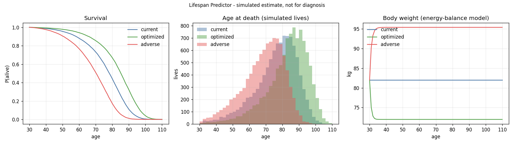

# 寿命预测器（Lifespan Predictor）

**模拟估算，不用于诊断。**

寿命预测器是一个面向中国成年人的寿命预测引擎。输入一个人现在的状态（年龄、性别、身高体重、吸烟、饮酒、身体活动、水果和鱼的摄入、睡眠），让同一个人分成三条未来，算出每条未来的剩余寿命分布、生存曲线和体重轨迹：

- **照现在**：现在的习惯一直保持。
- **优化**：证据最强的几项改好：戒烟、不每天喝酒、多动、多吃水果和鱼、睡够、体重回到合理区间。
- **多重不良**：几项现实中常一起出现的坏习惯叠加：重度吸烟、每天大量饮酒、几乎不动、饮食差、睡眠不足、长期热量盈余。

它给出的是概率分布。蒙特卡洛模拟的每一条人生只是一个样本，单条人生里的死亡年龄不代表任何人的结局。

这是第一版参考实现（Python），用来固定模型和参数口径。食探（FoodLink）的 Go 后端以后会读取同一份参数注册表。

## 快速开始

需要 Python ≥ 3.11 和 numpy；画图需要 matplotlib。

```bash
pip install -e ".[plot,dev]"
```

```bash
python -m lifespan_predictor --sex male --age 30 --height 175 --weight 82 --smoking current_lt20 --alcohol daily_1_29 --pa 14 --fruit 60 --fish 15 --sleep 6.5 --plot docs/example.png
```

```bash
python -m pytest
```

```python
from lifespan_predictor import Profile, simulate

result = simulate(Profile(sex="female", age=35, height_cm=162, weight_kg=60, pa_met_h=12))
summary = result.to_dict()  # JSON-ready：三个情景的分布、到达 70/80/90/100 岁的概率、体重、外推标记
```

也可以传入自定义情景（例如只让饮食分叉）：`simulate(profile, scenarios=(current(profile), my_diet_scenario))`，第一个情景是配对比较和滞后的参照；`Scenario` 定义在 `lifespan_predictor/scenarios.py`。`n_lives` 需要是参数抽样组数的整数倍。

输入取值：`smoking` ∈ never / former / current_lt20 / current_ge20；`alcohol` ∈ less_than_daily / daily_1_29 / daily_30_59 / daily_ge60（克纯酒精/天）；`pa` 为总身体活动 MET-h/天（职业+交通+家务+休闲，1 MET-h/d 约等于每天 15 分钟中等强度活动）；`fruit`、`fish` 为 g/天；`sleep` 为小时/晚；`energy-balance` 为长期每日能量盈余（kcal，默认 0 即体重稳定）。

## 示例

30 岁男性，175 cm / 82 kg，每天吸烟不到 20 支、每天少量饮酒、活动 14 MET-h/d、水果 60 g、鱼 15 g、睡 6.5 小时（10,000 条人生 = 100 组参数抽样 × 100 条人生，种子 20261024，滞后 τ = 2 年）：

| 情景 | 剩余寿命均值 | 中位数 | 10%–90% 分位 | 均值的参数不确定区间 | 活到 80 岁概率 | 体重（30 岁 → 110 岁） |
|---|---:|---:|---|---|---:|---|
| 照现在 | 46.2 年 | 48.3 | 28.3–60.5 | 45.4–46.7 | 44% | 82 → 82 kg |
| 优化 | 53.0 年 | 55.2 | 35.9–66.7 | 51.9–54.1 | 67% | 82 → 72 kg |
| 多重不良 | 38.4 年 | 40.3 | 20.7–52.7 | 37.7–39.0 | 17% | 82 → 95 kg |

配对比较（同一批人生、同一组参数）：优化比照现在平均 +6.8 年，多重不良平均 −7.7 年。优化情景每天 250 g 水果超出了 CKB 的观察范围（25–123 g），输出里带有外推标记。



## 模型结构

```
2020 年中国生命表（普查死亡率，校准到官方 e0）
        │
        ▼
个体死亡率 m_i(a) = m_pop(a) × exp(衰减(a) × Σ ln HR_i) / 参照人群平均 RR(a)
        │            ▲                              ▲
        │            │                              └─ CNHS 2015 公开汇总值合成的参照人群
        │            ├─ 吸烟、饮酒、身体活动、水果、鱼：CKB 2025 全因死亡模型
        │            ├─ BMI：GBMC 2016（总效应），BMI 由体重模型逐年更新
        │            └─ 睡眠：Cappuccio 2010 荟萃分析（收缩一半）
        ▼
三个情景 × D 组参数抽样 × L 条人生（共同随机数）→ 剩余寿命分布、生存曲线、体重轨迹
```

1. **基础死亡率**：国家统计局 2020 年人口普查逐岁死亡数据（表 6-4）。普查死亡有漏报，原始数据算出的 e0 是男 79.11 / 女 84.06，高于官方 75.37 / 80.88，所以每个性别乘一个系数（男 1.41 / 女 1.42）校准到官方值；95 岁以上用 80–94 岁的 Gompertz 曲线外推。校准后 30 岁预期寿命为男 46.33、女 51.54 年。构建脚本：`scripts/build_life_table.py`。
2. **风险调整**：吸烟、饮酒、身体活动、水果、鱼用 Nat Commun 2025 的 CKB 5 年死亡模型系数。这个模型同时调整了 BMI 和血压，所以这些系数是不经体重通路的效应。体重本身的效应用 GBMC 2016 的 BMI 曲线（从不吸烟、无慢病人群的总效应），体重的变化由下面的体重模型产生。这样同一条通路只计一次，避免重复计算。睡眠用 Cappuccio 2010，但 CKB 2025 的变量筛选没有保留睡眠，所以效应收缩一半（估算）。
3. **重新中心化**：生命表描述的是整个人群（吸烟和不吸烟、动和不动的人都在里面）。个体风险比除以参照人群的平均风险比，使具有 CNHS 暴露分布的人群正好复现生命表。参照人群只用论文公开的均值、SD 和比例合成，不用任何个体数据。
4. **高龄衰减**：CKB 基线 30–79 岁、随访约 12 年，90 岁以上几乎没有数据。所有 ln HR 在 80 岁后线性衰减，100 岁时减半（估算，没有为了贴合锚点而调整）。
5. **体重**：Hall 团队的两室能量分配模型（Chow & Hall 2008 参数，Forbes 分配，初始体脂用 Deurenberg 1991 公式）。优化情景通过长期能量摄入把 BMI 调到 20.5–23.5；多重不良情景每天多 250 kcal（估算，参考 Hall 2019 短期试验的 +508 kcal 取约一半）。测试里核对了 Hall 2011 的经验法则：每天 100 kJ 约对应最终 1 kg，半程约 1 年；100 kg 男性每天减 2 MJ，平台约 75 kg。
6. **年龄口径**：第 k 年覆盖实际年龄 [age+k, age+k+1)，逐岁死亡率视为 x+0.5 岁的值，在区间中点做对数线性插值，所以起始年龄带小数时结果连续变化。
7. **滞后**：行为改变后，非 BMI 部分的风险按 1 − exp(−t/τ) 过渡，τ 默认 2 年（估算，范围 0–10 年）。两篇校准论文都没有建模滞后，所以锚点检查用 τ = 0。
8. **蒙特卡洛与共同随机数**：每条人生有一个隐藏阈值 E ~ Exp(1) 和一组参数抽样（论文系数按 95% CI 正态抽样），三个情景共用这两样东西。人生在累积风险越过 E 时结束，所以情景之间的差异只来自风险本身，而不是“掷到了不同的骰子”。输出同时给出人生之间的差异（分位数）和参数不确定性（各组参数下期望剩余寿命的 2.5%–97.5% 区间）。

## 参数注册表

`registry/parameters.json` 是唯一的数据源，`registry/parameters.csv` 由 `scripts/export_registry_csv.py` 生成（测试会检查两者一致）。每个参数都有：id、领域、变量、暴露定义、参照水平、单位、效应类型、点估计（分男女）、范围、适用人群、来源（DOI/PMID/URL 与表格位置）、证据类型、状态，部分参数还有说明和用途。

状态只有两种：

- **论文**（39 项）：来自论文或官方统计，已联网核对。对数风险比的范围是论文的 95% CI。
- **估算**（13 项）：没有论文直接给出，写明理由和大致范围。包括：普查漏报校准系数、95 岁以上外推、身体活动对数截断、饮食效应封顶、睡眠分段和收缩、滞后 τ、高龄衰减、参照人群的分布形状和睡眠分布、三个情景的具体设定。

一处需要说明的单位理解：Nat Commun 2025 补充表 4 把水果、红肉、鱼的 β 单位写成“10 g/d”，但按这个单位换算出的 HR（水果每 10 g 0.88）和正文 Table 1（0.98）对不上；按“每 100 g/d”理解后与 Table 1 一致，本仓库采用后者（测试 `test_diet_unit_interpretation_matches_table1_hr_per_10g` 固定了这个理解）。红肉在 CKB 中表现为“多吃风险低”，很可能是收入和营养状况的混杂，引擎把红肉固定在中心值，不作为可调变量。

## 校准锚点

完整结果见 [docs/anchor_results.md](docs/anchor_results.md)（`python scripts/run_anchors.py` 生成），检查写在 `tests/test_anchors.py`。

**Nat Commun 2025**（把论文的理想/现实情景作用到 CNHS 参照人群上，比较 30 岁预期寿命）：

| | 本模型 | 论文（95% CI） | 差 |
|---|---:|---|---:|
| 男 理想情景 | +5.10 | +4.83（4.01–5.82） | +6% |
| 男 现实情景 | +2.41 | +2.61（2.15–3.17） | −8% |
| 女 理想情景 | +5.98 | +5.39（4.70–6.18） | +11% |
| 女 现实情景 | +2.87 | +3.10（2.67–3.59） | −8% |

四项合计情景都落在论文自己的 95% CI 内。单项拆开看有偏差：饮食单项偏高（男 +8%、女 +26%），身体活动单项偏低（男 0.32 vs 0.72、女 0.58 vs 1.47），两者部分抵消。身体活动偏低的主要原因是对数项在 2 MET-h/d 截断，而真实 CNHS 数据中活动量接近 0 的人更多（参照人群用对数正态分布近似）。另外本模型的基准 30 岁预期寿命用 2020 年全国数据（男 46.33 / 女 51.54），论文基于 CKB 模型的基准是 45.46 / 47.00，女性差得较多，基准越长，同样的风险下降换来的年数越多。

**Lancet Public Health 2022**（参照人群中 5 项低风险因素全满足者 vs 只满足 0–1 项者）：

| | 本模型 | 论文（95% CI） | 差 |
|---|---:|---|---:|
| 男 30 岁 LE 差 | +8.77 | +8.8（6.8–10.7） | −0% |
| 女 30 岁 LE 差 | +10.85 | +8.1（6.5–9.9） | +34% |
| 男 RR（5 项 vs 0–1 项） | 0.41 | HR 0.38（0.34–0.43，男女合并） | |
| 女 RR | 0.25 | 同上 | |

男性落在论文 CI 内。**女性高出 34%，是目前最大的偏差**（参照人群每 5 岁组 5 万人，换随机种子结果在 10.8–10.85 之间，不是抽样噪声）。可能的原因：CKB 2025 女性模型的鱼、水果和身体活动系数明显强于男性；参照人群里满足 0–1 项的女性只有 0.3%（几乎所有女性不吸烟、不过量饮酒），这一组由少数吸烟或大量饮酒的女性构成，而参照人群假设各因素相互独立，真实人群中吸烟和饮酒是一起出现的；论文的饮食评分包含蔬菜、豆类和红肉频率，本模型只能用水果和鱼近似，腰围也没有建模。两端都有偏差：0–1 项组 30 岁 LE 本模型 45.6 vs 论文 47.3，5 项组 56.6 vs 55.4。测试对女性只要求在论文点估计的 0.6–1.5 倍内（量级一致）。

**敏感性**：如果不做高龄衰减（80 岁后仍按原 HR），男/女理想情景为 +5.41 / +6.79（女性超出 CI），现实情景 +2.50 / +3.11，CKB 2022 对比为 +9.08 / +11.51。

## 目录

```
data/raw/census2020_table6-4.xls   国家统计局原始表（未改动）
data/cn_life_table_2020.csv        校准后的逐岁生命表（含原始 m_x）
registry/parameters.json           参数注册表（唯一数据源）
registry/parameters.csv            注册表的扁平导出（给 Go / 表格软件）
lifespan_predictor/                引擎：life_table、hazards、population、weight、scenarios、simulate、anchors
scripts/                           生命表构建、注册表导出、锚点报告
tests/                             单元测试 + 校准锚点检查
docs/sources.md                    每个来源的标识和核对方式
docs/anchor_results.md             锚点检查完整结果
```

## 数据使用与许可

- 没有使用 CKB、CNHS 的原始个体数据（它们需要申请，CNHS 汇总数据协议限非商业研究），只使用论文公开的参数和汇总值。
- 论文代码仓库 `qiufen-code/lifestyle-simulation-study` 没有许可证，本仓库没有复用其中任何代码，全部独立实现。
- 本仓库自身的许可证尚未选定，公开发布前由作者决定。

## 局限与还没做的

- 只覆盖六个领域（BMI、饮食、吸烟、饮酒、身体活动、睡眠），没有疾病状态、血压/血糖、心理、社会、环境、医疗管理模块，所以输出的只有全因死亡，没有健康寿命或带病年数。
- 饮食只用水果和鱼两个变量（CKB 模型的变量），还不能直接读取食探的完整饮食记录或饮食质量评分。
- 优化和多重不良情景都假设 100% 长期执行，没有依从性模块。
- 体重模型用简化版能耗公式，没有适应性产热和随年龄的体成分变化；Deurenberg 公式可能低估中国人体脂。
- 风险比对所有成年年龄一样（80 岁后衰减），没有年龄交互；18–29 岁和 80 岁以上属于外推（输出会标记）。
- 参数不确定性只抽样论文系数，估算参数（衰减、收缩、滞后、能量盈余等）需要做结构敏感性分析，还没有做成自动报告。论文系数的 SE 由 Table 1 两位小数的 HR 置信区间反推（补充表 4 只给 β、没给 SE），会有一定误差。
- 参照人群各因素独立抽样，没有建模吸烟与饮酒等因素的相关。
- 随机数用 numpy 的 PCG64，Go 端要逐位复现需要换成可移植的生成器（见交接清单）。
- 还没有和食探的 Go 后端对接，也没有接口服务。
